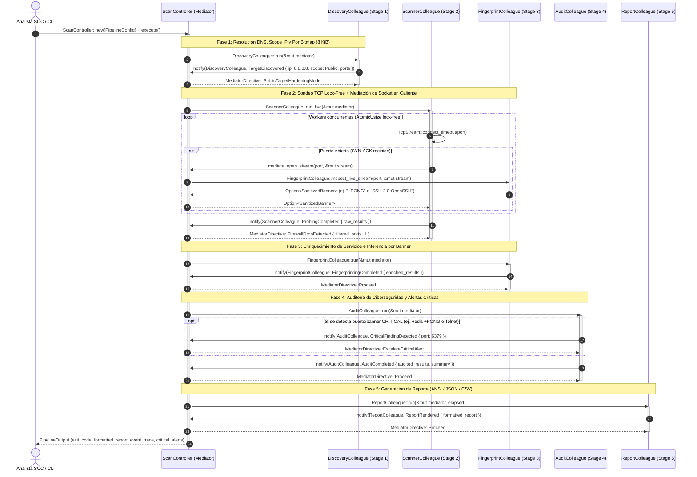
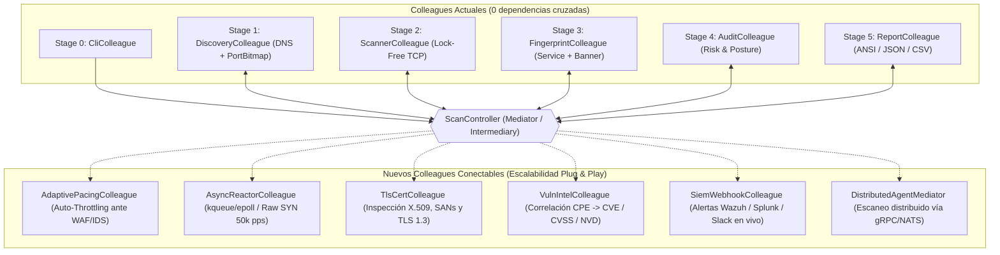

# Patrón de Diseño Mediator (Mediador / Intermediary / Controller) en `tcpscan` v2.0

Este documento detalla la implementación del patrón de comportamiento **Mediator (GoF)** dentro del escáner de puertos TCP de ciberseguridad `tcpscan` (`HXSCAN` Rust Edition), sus **diagramas UML** (Clases, Secuencia, Estados y Topología de Componentes) y la **propuesta de escalabilidad óptima** hacia una plataforma SOC / Pentesting distribuida.

---

## 1. ¿Por qué el Patrón Mediator en un Escáner TCP de Ciberseguridad?

Antes de aplicar el patrón **Mediator**, las etapas de un escáner suelen acoplarse en cadena o en malla (*spaghetti coupling*):
- El motor de sockets (`Stage 2`) necesitaba conocer detalles del *Banner Grabber* (`Stage 3`).
- El motor de auditoría (`Stage 4`) importaba estructuras internas de `Stage 1`, `Stage 2` y `Stage 3`.
- El generador de reportes (`Stage 5`) dependía directamente de todas las etapas previas.

Con el patrón **Mediator** ([`src/mediator/`](src/mediator/mod.rs)):
1. **Desacoplamiento Total entre Colegas (`0` imports cruzados)**:
   Ninguno de los 5 módulos en [`src/stages/`](src/stages/mod.rs) importa a otro módulo hermano. Todos dependen **exclusivamente** del contrato [`crate::mediator::contract`](src/mediator/contract.rs).
2. **Topología en Estrella alrededor de `ScanController`**:
   Cada etapa actúa como un **Colega (`Colleague`)** que ejecuta su responsabilidad atómica y notifica al mediador mediante `mediator.notify(ComponentId, ScanEvent)`.
3. **Mediación Reactiva en Tiempo Real (`MediatorDirective`)**:
   El mediador ([`ScanController`](src/mediator/controller.rs)) no es un simple pasamanos pasivo; inspecciona cada evento y toma decisiones tácticas de ciberseguridad:
   - Si `DiscoveryColleague` resuelve una IP pública (`AddressScope::Public`), emite `MediatorDirective::PublicTargetHardeningMode`.
   - Cuando `ScannerColleague` abre un socket TCP (`SYN-ACK`), invoca `mediator.mediate_open_stream(port, &mut stream)`. El mediador decide si delegar la inspección del socket activo a `FingerprintColleague` sin que `ScannerColleague` sepa siquiera que `FingerprintColleague` existe.
   - Si `ScannerColleague` detecta puertos en estado `Filtered` (timeout por *packet drop*), el mediador emite `MediatorDirective::FirewallDropDetected`.
   - Si `AuditColleague` detecta un riesgo crítico (ej. Redis sin contraseña `+PONG` o Telnet expuesto), emite `ScanEvent::CriticalFindingDetected` al instante y el mediador registra la alerta prioritaria (`EscalateCriticalAlert`).

---

## 2. Diagramas UML de la Arquitectura

### 2.1. Diagrama UML de Clases (`Class Diagram`)

```mermaid
classDiagram
    direction TB

    class ScanMediator {
        <<interface>>
        +notify(sender: ComponentId, event: ScanEvent) MediatorDirective
        +mediate_open_stream(port: u16, stream: &mut TcpStream) Option~String~
    }

    class ScanController {
        +config: PipelineConfig
        -state: MediatorState
        -event_trace: Vec~MediatedEventRecord~
        -critical_alerts: Vec~String~
        -target: Option~TargetInfo~
        -ports: Vec~u16~
        -raw_results: Vec~RawProbeResult~
        -enriched_results: Vec~EnrichedPortResult~
        -audited_results: Vec~AuditedPortResult~
        -summary: Option~SecurityPostureSummary~
        +new(config: PipelineConfig) ScanController
        +execute() Result~PipelineOutput, DiscoveryError~
        +execute_with_prober(prober: P) Result~PipelineOutput, DiscoveryError~
        +state() MediatorState
        +event_trace() Slice~MediatedEventRecord~
    }

    class DiscoveryColleague {
        <<Colleague Stage 1>>
        +run(mediator: &mut ScanController, seed: u64) Result~MediatorDirective, DiscoveryError~
        +resolve_target(target: &str) Result~TargetInfo, DiscoveryError~
        +parse_port_spec(spec: &str) Result~Vec~u16~, DiscoveryError~
        +shuffle_ports(ports: &mut [u16], seed: u64)
    }

    class ScannerColleague {
        <<Colleague Stage 2>>
        +run_live(mediator: &mut ScanController) MediatorDirective
        +run_with_prober(mediator: &mut ScanController, prober: P) MediatorDirective
        +probe_single_port(ip: IpAddr, port: u16, timeout: Duration, retries: u8) RawProbeResult
    }

    class FingerprintColleague {
        <<Colleague Stage 3>>
        +run(mediator: &mut ScanController) MediatorDirective
        +inspect_live_stream(port: u16, stream: &mut TcpStream, timeout: Duration) Option~String~
        +get_service_name(port: u16) str
        +grab_banner_from_rw(port: u16, stream: &mut S) Option~String~
    }

    class AuditColleague {
        <<Colleague Stage 4>>
        +run(mediator: &mut ScanController) MediatorDirective
        +evaluate_port_security(item: EnrichedPortResult, scope: AddressScope) AuditedPortResult
        +execute_audit_stage(enriched: Vec~EnrichedPortResult~, scope: AddressScope) Tuple
    }

    class ReportColleague {
        <<Colleague Stage 5>>
        +run(mediator: &mut ScanController, elapsed: Duration) MediatorDirective
        +render_report(target: &TargetInfo, results: &[AuditedPortResult], summary: &SecurityPostureSummary) String
    }

    class ScanEvent {
        <<enumeration>>
        TargetDiscovered
        ProbingCompleted
        FingerprintingCompleted
        CriticalFindingDetected
        AuditCompleted
        ReportRendered
    }

    class MediatorDirective {
        <<enumeration>>
        Proceed
        PublicTargetHardeningMode
        FirewallDropDetected
        EscalateCriticalAlert
    }

    ScanMediator <|.. ScanController : implements
    ScanController ..> ScanEvent : processes
    ScanController ..> MediatorDirective : issues
    DiscoveryColleague --> ScanMediator : notifies TargetDiscovered
    ScannerColleague --> ScanMediator : notifies ProbingCompleted & mediate_open_stream()
    FingerprintColleague --> ScanMediator : notifies FingerprintingCompleted
    AuditColleague --> ScanMediator : notifies CriticalFindingDetected & AuditCompleted
    ReportColleague --> ScanMediator : notifies ReportRendered
```

Representa la interfaz `<<interface>> ScanMediator`, el mediador concreto `ScanController`, los contratos de eventos (`ScanEvent`, `MediatorDirective`) y los 5 colegas desacoplados (`DiscoveryColleague`, `ScannerColleague`, `FingerprintColleague`, `AuditColleague`, `ReportColleague`).



---

### 2.2. Diagrama UML de Secuencia (`Sequence Diagram`)

Muestra el flujo completo de mediación cuando el analista ejecuta `./tcpscan 8.8.8.8 22,80,6379,9999`:



---

### 2.3. Diagrama UML de Máquina de Estados del Mediador (`State Diagram`)

Representa las transiciones de estado internas (`MediatorState`) gobernadas por `ScanController`:

```mermaid
stateDiagram-v2
    [*] --> Idle : ScanController::new()
    Idle --> Discovering : execute() inicia Etapa 1
    Discovering --> Failed : Error DNS / Rango de puertos inválido
    Discovering --> Probing : ScanEvent::TargetDiscovered
    Probing --> Fingerprinting : ScanEvent::ProbingCompleted
    Fingerprinting --> Auditing : ScanEvent::FingerprintingCompleted
    Auditing --> Auditing : ScanEvent::CriticalFindingDetected (Acumula alerta)
    Auditing --> Reporting : ScanEvent::AuditCompleted
    Reporting --> Completed : ScanEvent::ReportRendered
    Failed --> [*] : Exit Code 1
    Completed --> [*] : Exit Code 0 (Open > 0) o 2 (Open == 0)
```

---

### 2.4. Diagrama de Topología Desacoplada vs. Escalabilidad Futura (`Component Flowchart`)

Gracias al patrón **Mediator**, conectar nuevos módulos de ciberseguridad no requiere tocar ni una sola línea de los colegas existentes:



---

## 3. Propuesta de Escalabilidad Óptima: ¿Cómo Funcionaría a Gran Escala?

El patrón **Mediator** convierte a `tcpscan` en una arquitectura *Event-Driven* lista para escalar en **4 dimensiones clave** sin reescribir la lógica existente:

### 3.1. Escalabilidad de Rendimiento de Red: `AsyncReactorColleague` (`kqueue` / `epoll` / `io_uring`)
- **Problema al escalar a redes `/16` (65,535 IPs $\times$ 1,000 puertos)**: Crear hilos de sistema operativo tiene un límite físico de descriptores de archivo (`ulimit -n`) y memoria de stack por hilo.
- **Cómo funcionaría con el Mediador**:
  - Se añade un nuevo colega `AsyncReactorColleague` que implementa la misma notificación `ScanEvent::ProbingCompleted`.
  - Utiliza sockets no bloqueantes (`O_NONBLOCK`) registrados en `kqueue` (macOS/BSD) o `epoll`/`io_uring` (Linux) con una máquina de estados en un solo hilo por núcleo CPU, manteniendo hasta **10,000 conexiones TCP `SYN_SENT` en vuelo simultáneamente con < 2 MB de RAM**.
  - El `ScanController` selecciona automáticamente `ScannerColleague` (hilos nativos) cuando el lote es $< 2,000$ sondas y conmuta a `AsyncReactorColleague` cuando el lote supera $2,000$ sondas.

### 3.2. Escalabilidad Táctica Anti-IDS/Firewall: `AdaptivePacingColleague` (Control de Congestión y Evasión)
- **Cómo funcionaría**:
  - Cuando `ScannerColleague` reporta eventos de puertos filtrados (`PortState::Filtered`) o aumentos bruscos en el `rtt_micros`, el Mediador invoca a `AdaptivePacingColleague`.
  - Este colega aplica un algoritmo tipo **AIMD (Additive Increase / Multiplicative Decrease)** similar a TCP Vegas/BBR: si la tasa de *timeouts* supera el 25%, el Mediador inyecta dinámicamente un *jitter* aleatorio (`15ms–80ms`) y reduce los hilos activos para evitar que el firewall perimetral o Fail2ban bloquee la IP del auditor.

### 3.3. Escalabilidad de Inteligencia de Amenazas: `VulnIntelColleague` + `TlsCertColleague`
- **Cómo funcionaría**:
  - **Inspección TLS (`TlsCertColleague`)**: Cuando `ScannerColleague` detecta abiertos los puertos `443`, `8443`, `6443`, `993` o `2376`, el Mediador enruta el stream hacia `TlsCertColleague` para extraer el certificado X.509 (`Subject`, `SANs` para descubrir subdominios ocultos, fecha de expiración y cifrados débiles).
  - **Correlación CVE (`VulnIntelColleague`)**: Se suscribe en el Mediador al evento `ScanEvent::FingerprintingCompleted`. Transforma banners como `OpenSSH_9.7p1` o `nginx/1.26.0` en identificadores **CPE 2.3** (`cpe:2.3:a:openbsd:openssh:9.7p1:*:*:*:*:*:*:*`) y consulta una base local indexada (SQLite/FST) de NVD/CISA KEV para adjuntar la lista exacta de **CVEs explotables** antes de que `AuditColleague` calcule el puntaje de riesgo.

### 3.4. Escalabilidad Distribuida (SOC / Red Team Cluster): `DistributedClusterMediator`
- **Cómo funcionaría**:
  - En lugar de instanciar `ScanController` en memoria local, se implementa el mismo trait [`ScanMediator`](src/mediator/contract.rs#L359-L368) sobre un transporte de red (`DistributedClusterMediator` usando gRPC, WebSockets o NATS).
  - Un nodo central (**Controller**) particiona un segmento corporativo (`10.0.0.0/8`) en sub-tareas y las reparte entre múltiples agentes ligeros (`ScannerColleague` desplegados en distintas VLANs o contenedores).
  - Cada agente remoto envía sus `ScanEvent` al Mediador central, el cual consolida todo en un único reporte global para el SIEM (`Splunk`, `Elastic Security`, `Wazuh`) y dispara alertas en tiempo real al recibir `ScanEvent::CriticalFindingDetected`.
