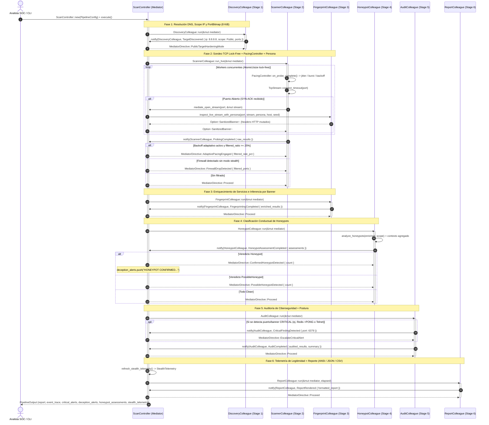
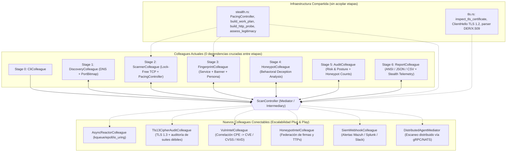
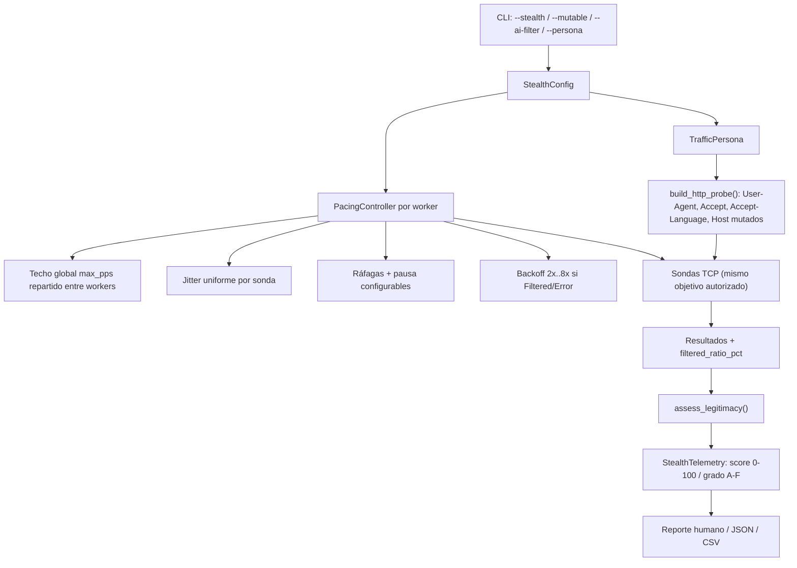
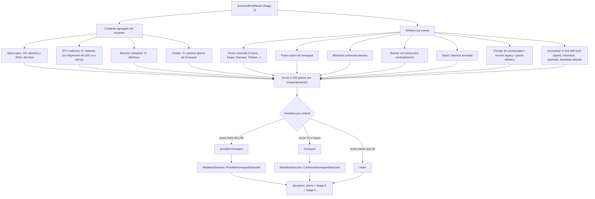

# Patrón de Diseño Mediator (Mediador / Intermediary / Controller) en `tcpscan` v3.0 ("Ultimate Recon Edition")

Este documento detalla la implementación del patrón de comportamiento **Mediator (GoF)** dentro del escáner de puertos TCP de ciberseguridad `tcpscan` (`HXSCAN` Rust Edition), sus **diagramas UML** (Clases, Secuencia, Estados y Topología de Componentes), los **flujos de decisión** introducidos en las versiones 2.1 y 2.2 (legitimidad anti-IA, reconocimiento TLS/X.509, extracción de versión de servicio y clasificación de honeypots) y la **propuesta de escalabilidad óptima** hacia una plataforma SOC / Pentesting distribuida.

---

## 1. ¿Por qué el Patrón Mediator en un Escáner TCP de Ciberseguridad?

Antes de aplicar el patrón **Mediator**, las etapas de un escáner suelen acoplarse en cadena o en malla (*spaghetti coupling*):
- El motor de sockets (`Stage 2`) necesitaba conocer detalles del *Banner Grabber* (`Stage 3`).
- El motor de auditoría (`Stage 5`) importaba estructuras internas de `Stage 1`, `Stage 2`, `Stage 3` y `Stage 4`.
- El generador de reportes (`Stage 6`) dependía directamente de todas las etapas previas.
- Cualquier nueva capacidad (por ejemplo, detectar honeypots) obligaba a modificar varias etapas a la vez.

Con el patrón **Mediator** ([`src/mediator/`](src/mediator/mod.rs)):

1. **Desacoplamiento Total entre Colegas (`0` imports cruzados)**:
   Ninguno de los **6 módulos** en [`src/stages/`](src/stages/mod.rs) importa a otro módulo hermano. Todos dependen **exclusivamente** del contrato [`crate::mediator::contract`](src/mediator/contract.rs). La infraestructura transversal de cadencia/mutación ([`src/stealth.rs`](src/stealth.rs)) y de reconocimiento TLS/X.509 ([`src/tls.rs`](src/tls.rs)) es consumida por `Stage 2`, `Stage 3` y el Mediador, sin crear dependencias entre etapas.
2. **Topología en Estrella alrededor de `ScanController`**:
   Cada etapa actúa como un **Colega (`Colleague`)** que ejecuta su responsabilidad atómica y notifica al mediador mediante `mediator.notify(ComponentId, ScanEvent)`.
3. **Mediación Reactiva en Tiempo Real (`MediatorDirective`)**:
   El mediador ([`ScanController`](src/mediator/controller.rs)) no es un simple pasamanos pasivo; inspecciona cada evento y toma decisiones tácticas de ciberseguridad:
   - Si `DiscoveryColleague` resuelve una IP pública (`AddressScope::Public`), emite `MediatorDirective::PublicTargetHardeningMode`.
   - Cuando `ScannerColleague` abre un socket TCP (`SYN-ACK`), invoca `mediator.mediate_open_stream(port, &mut stream)`. En puertos TLS-like (`443`, `8443`, `6443`, etc.), el mediador negocia un `ClientHello` TLS 1.2 mínimo ([`src/tls.rs`](src/tls.rs)), extrae los metadatos del certificado X.509 y los almacena en `tls_certificates: Mutex<HashMap<u16, TlsCertificateInfo>>` (cold path; el reparto de sondas en `Stage 2` sigue siendo 100% *lock-free* con `AtomicUsize`). En el resto de puertos, delega la inspección del socket activo a `FingerprintColleague` e inyecta la **persona de tráfico** configurada sin que `ScannerColleague` conozca `FingerprintColleague` ni `tls.rs`.
   - En `Stage 3`, `FingerprintColleague` consulta `mediator.tls_certificate(port)` para adjuntar el certificado capturado y extrae la versión del servicio (`extract_service_version`) a partir de los banners existentes, sin tráfico adicional.
   - Si `ScannerColleague` detecta puertos `Filtered` y el backoff adaptativo está activo, el mediador emite `MediatorDirective::AdaptivePacingEngaged`; en caso contrario, `FirewallDropDetected`.
   - `HoneypotColleague` analiza el comportamiento agregado y las anomalías del certificado TLS (`SelfSignedCertificate`, `CertificateHostnameMismatch`, `ExpiredCertificate`, `DefaultCertificateIdentity`), respondiendo con `PossibleHoneypotDetected` o `ConfirmedHoneypotDetected`, que el Mediador convierte en alertas de decepción (`deception_alerts`).
   - Si `AuditColleague` detecta un riesgo crítico (p. ej. Redis sin contraseña `+PONG` o Telnet expuesto), emite `ScanEvent::CriticalFindingDetected` al instante y el mediador registra la alerta prioritaria (`EscalateCriticalAlert`).
4. **Escalabilidad Plug & Play demostrada**:
   La incorporación de `HoneypotColleague` como **Stage 4** (v2.1) y el reconocimiento TLS/X.509 + versiones de servicio (v2.2) se realizaron sin acoplar los colegas entre sí. Solo se extendieron el contrato, el controlador y las etapas consumidoras; exactamente el tipo de evolución que el patrón busca habilitar.

---

## 2. Diagramas UML de la Arquitectura

### 2.1. Diagrama UML de Clases (`Class Diagram`)

```mermaid
classDiagram
    direction TB

    class ScanMediator {
        <<interface>>
        +notify(sender: ComponentId, event: ScanEvent) MediatorDirective
        +mediate_open_stream(port: u16, stream: &mut TcpStream) Option~String~
        +tls_certificate(port: u16) Option~TlsCertificateInfo~
    }

    class ScanController {
        +config: PipelineConfig
        -state: MediatorState
        -event_trace: Vec~MediatedEventRecord~
        -critical_alerts: Vec~String~
        -deception_alerts: Vec~String~
        -target: Option~TargetInfo~
        -ports: Vec~u16~
        -raw_results: Vec~RawProbeResult~
        -enriched_results: Vec~EnrichedPortResult~
        -honeypot_assessments: Vec~HoneypotAssessment~
        -audited_results: Vec~AuditedPortResult~
        -summary: Option~SecurityPostureSummary~
        -stealth_telemetry: Option~StealthTelemetry~
        -tls_certificates: Mutex~HashMap~u16, TlsCertificateInfo~~
        +new(config: PipelineConfig) ScanController
        +execute() Result~PipelineOutput, DiscoveryError~
        +execute_with_prober(prober: P) Result~PipelineOutput, DiscoveryError~
        -refresh_stealth_telemetry()
        +state() MediatorState
        +event_trace() Slice~MediatedEventRecord~
    }

    class DiscoveryColleague {
        <<Colleague Stage 1>>
        +run(mediator: &mut ScanController, seed: u64) Result~MediatorDirective, DiscoveryError~
        +resolve_target(target: &str) Result~TargetInfo, DiscoveryError~
        +parse_port_spec(spec: &str) Result~Vec~u16~, DiscoveryError~
        +shuffle_ports(ports: &mut [u16], seed: u64)
    }

    class ScannerColleague {
        <<Colleague Stage 2>>
        +run_live(mediator: &mut ScanController) MediatorDirective
        +run_with_prober(mediator: &mut ScanController, prober: P) MediatorDirective
        +probe_single_port(ip: IpAddr, port: u16, timeout: Duration, retries: u8) RawProbeResult
    }

    class FingerprintColleague {
        <<Colleague Stage 3>>
        +run(mediator: &mut ScanController) MediatorDirective
        +inspect_live_stream(port: u16, stream: &mut TcpStream, timeout: Duration) Option~String~
        +inspect_live_stream_with_persona(port: u16, stream: &mut TcpStream, timeout: Duration, persona: TrafficPersona, host: &str, seed: u64) Option~String~
        +grab_banner_from_rw(port: u16, stream: &mut S) Option~String~
        +grab_banner_from_rw_with_persona(port: u16, stream: &mut S, persona: TrafficPersona, host: &str, seed: u64) Option~String~
        +get_service_name(port: u16) str
    }

    class HoneypotColleague {
        <<Colleague Stage 4>>
        +run(mediator: &mut ScanController) MediatorDirective
        +analyze_honeypots(enriched: &[EnrichedPortResult], scope: AddressScope) Vec~HoneypotAssessment~
        +evaluate_honeypot_port(item: &EnrichedPortResult, scope: AddressScope) HoneypotAssessment
    }

    class AuditColleague {
        <<Colleague Stage 5>>
        +run(mediator: &mut ScanController) MediatorDirective
        +evaluate_port_security(item: EnrichedPortResult, scope: AddressScope) AuditedPortResult
        +evaluate_port_security_with_honeypot(item: EnrichedPortResult, scope: AddressScope, honeypot: HoneypotAssessment) AuditedPortResult
        +execute_audit_stage(enriched: Vec~EnrichedPortResult~, scope: AddressScope) Tuple
        +execute_audit_stage_with_honeypots(enriched: Vec~EnrichedPortResult~, scope: AddressScope, honeypots: &[HoneypotAssessment]) Tuple
    }

    class ReportColleague {
        <<Colleague Stage 6>>
        +run(mediator: &mut ScanController, elapsed: Duration) MediatorDirective
        +render_report(target: &TargetInfo, results: &[AuditedPortResult], summary: &SecurityPostureSummary) String
        +render_report_with_stealth(target: &TargetInfo, results: &[AuditedPortResult], summary: &SecurityPostureSummary, stealth: &StealthTelemetry) String
    }

    class StealthConfig {
        <<configuration>>
        +mode: StealthMode
        +persona: TrafficPersona
        +jitter: Duration
        +max_pps: f64
        +burst_size: usize
        +burst_pause: Duration
        +adaptive_backoff: bool
        +decoy_probes: usize
        +ai_filter: bool
    }

    class PacingController {
        <<stealth module>>
        -base_interval: Duration
        -jitter: Duration
        -burst_size: usize
        -burst_pause: Duration
        -backoff: u32
        +new(config: &ScannerConfig, worker_count: usize, seed: u64) PacingController
        +on_probe_complete(state: &PortState) Duration
    }

    class StealthTelemetry {
        <<telemetry>>
        +mode: StealthMode
        +persona: TrafficPersona
        +ai_filter: bool
        +max_pps: f64
        +jitter_ms: u64
        +burst_size: usize
        +burst_pause_ms: u64
        +decoy_probes: usize
        +adaptive_backoff: bool
        +filtered_ratio_pct: u8
        +legitimacy_score: u8
        +legitimacy_grade: char
    }

    class HoneypotAssessment {
        <<assessment>>
        +port: u16
        +verdict: HoneypotVerdict
        +score: u8
        +behaviors: Vec~HoneypotBehavior~
        +notes: String
        +clean(port: u16) HoneypotAssessment
        +is_suspicious() bool
        +behavior_summary() String
    }

    class HoneypotVerdict {
        <<enumeration>>
        Clean
        PossibleHoneypot
        Honeypot
    }

    class HoneypotBehavior {
        <<enumeration>>
        KnownHoneypotSignature
        HoneypotPort
        ServicePortMismatch
        ContradictoryBanner
        TarpitLatency
        MassOpenServices
        UniformRtt
        ClonedBanners
        DefaultCredentialPrompt
        FakeVersionDisclosure
        BannerlessInteractiveService
        UnusualEphemeralService
        HoneypotPortCluster
        SelfSignedCertificate
        CertificateHostnameMismatch
        ExpiredCertificate
        DefaultCertificateIdentity
    }

    class TlsCertificateInfo {
        <<tls intelligence>>
        +subject_cn: Option~String~
        +issuer_cn: Option~String~
        +sans: Vec~String~
        +not_after: Option~String~
        +days_until_expiry: Option~i64~
        +self_signed: bool
        +hostname_mismatch: bool
        +chain_length: usize
        +identity() str
        +is_expired() bool
    }

    class ScanEvent {
        <<enumeration>>
        TargetDiscovered
        ProbingCompleted
        FingerprintingCompleted
        HoneypotAssessmentCompleted
        CriticalFindingDetected
        AuditCompleted
        ReportRendered
    }

    class MediatorDirective {
        <<enumeration>>
        Proceed
        PublicTargetHardeningMode
        FirewallDropDetected
        AdaptivePacingEngaged
        PossibleHoneypotDetected
        ConfirmedHoneypotDetected
        EscalateCriticalAlert
    }

    ScanMediator <|.. ScanController : implements
    ScanController ..> ScanEvent : processes
    ScanController ..> MediatorDirective : issues
    ScanController *-- StealthConfig : configures
    ScanController o-- HoneypotAssessment : aggregates
    ScanController ..> StealthTelemetry : renders

    DiscoveryColleague --> ScanMediator : notifies TargetDiscovered
    ScannerColleague --> ScanMediator : notifies ProbingCompleted & mediate_open_stream()
    FingerprintColleague --> ScanMediator : notifies FingerprintingCompleted
    HoneypotColleague --> ScanMediator : notifies HoneypotAssessmentCompleted
    AuditColleague --> ScanMediator : notifies CriticalFindingDetected & AuditCompleted
    ReportColleague --> ScanMediator : notifies ReportRendered

    ScannerColleague ..> PacingController : uses per worker
    PacingController ..> StealthConfig : reads
    FingerprintColleague ..> StealthConfig : reads persona
    HoneypotColleague ..> HoneypotAssessment : produces
    HoneypotAssessment --> HoneypotVerdict
    HoneypotAssessment --> HoneypotBehavior
    ReportColleague ..> StealthTelemetry : renders
```

Representa la interfaz `<<interface>> ScanMediator`, el mediador concreto `ScanController`, los contratos de eventos (`ScanEvent`, `MediatorDirective`), la configuración/telemetría stealth y los **6 colegas desacoplados** (`DiscoveryColleague`, `ScannerColleague`, `FingerprintColleague`, `HoneypotColleague`, `AuditColleague`, `ReportColleague`).



---

### 2.2. Diagrama UML de Secuencia (`Sequence Diagram`)

Muestra el flujo completo de mediación cuando el analista ejecuta `./tcpscan 8.8.8.8 22,80,6379,9999 --mutable`:



---

### 2.3. Diagrama UML de Máquina de Estados del Mediador (`State Diagram`)

Representa las transiciones de estado internas (`MediatorState`) gobernadas por `ScanController`:

```mermaid
stateDiagram-v2
    [*] --> Idle : ScanController::new()
    Idle --> Discovering : execute() inicia Etapa 1
    Discovering --> Failed : Error DNS / Rango de puertos inválido
    Discovering --> Probing : ScanEvent::TargetDiscovered
    Probing --> Fingerprinting : ScanEvent::ProbingCompleted
    Fingerprinting --> HoneypotAnalysis : ScanEvent::FingerprintingCompleted
    HoneypotAnalysis --> Auditing : ScanEvent::HoneypotAssessmentCompleted (guarda veredictos)
    Auditing --> Auditing : ScanEvent::CriticalFindingDetected (acumula alerta)
    Auditing --> Reporting : ScanEvent::AuditCompleted
    Reporting --> Completed : ScanEvent::ReportRendered
    Failed --> [*] : Exit Code 1
    Completed --> [*] : Exit Code 0 (Open > 0) o 2 (Open == 0)
```

---

### 2.4. Diagrama de Topología Desacoplada vs. Escalabilidad Futura (`Component Flowchart`)

Gracias al patrón **Mediator**, conectar nuevos módulos de ciberseguridad no requiere tocar ni una sola línea de los colegas existentes. La v2.1 lo demuestra insertando `HoneypotColleague` entre `FingerprintColleague` y `AuditColleague`:



> `AdaptivePacingColleague` ya no aparece como trabajo futuro: su lógica se integró en `Stage 2` mediante `PacingController` y la directiva `AdaptivePacingEngaged`.

---

### 2.5. Flujo del Sobre de Legitimidad Anti-IA (`Legitimacy Funnel`)

Este flujo muestra cómo el CLI transforma la configuración del analista en una cadencia y una identidad de tráfico, y cómo se calcula la telemetría de legitimidad que se adjunta al reporte:



**Límite explícito**: este sobre reduce firmas evidentes y mantiene la cadencia dentro de envelopes de tráfico empresarial. No demuestra ni garantiza evasión de sistemas AI/ML, IDS/IPS o EDR. El score es una **autoevaluación honesta**, no una certificación de invisibilidad.

---

### 2.6. Flujo de Clasificación Conductual de Honeypots (`Deception Decision Flow`)



---

## 3. Propuesta de Escalabilidad Óptima: ¿Cómo Funcionaría a Gran Escala?

El patrón **Mediator** convierte a `tcpscan` en una arquitectura *Event-Driven* lista para escalar en **6 dimensiones clave** sin reescribir la lógica existente:

### 3.1. Escalabilidad de Rendimiento de Red: `AsyncReactorColleague` (`kqueue` / `epoll` / `io_uring`)
- **Problema al escalar a redes `/16` (65,535 IPs $\times$ 1,000 puertos)**: Crear hilos de sistema operativo tiene un límite físico de descriptores de archivo (`ulimit -n`) y memoria de stack por hilo.
- **Cómo funcionaría con el Mediador**:
  - Se añade un nuevo colega `AsyncReactorColleague` que implementa la misma notificación `ScanEvent::ProbingCompleted`.
  - Utiliza sockets no bloqueantes (`O_NONBLOCK`) registrados en `kqueue` (macOS/BSD) o `epoll`/`io_uring` (Linux) con una máquina de estados en un solo hilo por núcleo CPU, manteniendo hasta **10,000 conexiones TCP `SYN_SENT` en vuelo simultáneamente con < 2 MB de RAM**.
  - El `ScanController` selecciona automáticamente `ScannerColleague` (hilos nativos) cuando el lote es $< 2,000$ sondas y conmuta a `AsyncReactorColleague` cuando el lote supera $2,000$ sondas.

### 3.2. Escalabilidad Táctica Anti-IDS/Firewall: `PacingController` + `AdaptivePacingEngaged`
- **Estado actual (v2.1)**: el control de congestión ya está integrado en `Stage 2`. Cada worker mantiene su propio `PacingController` con jitter, techo `max_pps` distribuido, ráfagas y backoff exponencial (hasta `8x`) ante `Filtered`/`Error`. El Mediador observa el `filtered_ratio` y emite `AdaptivePacingEngaged` cuando supera el 25% en modo stealth/mutable.
- **Evolución futura**:
  - Añadir un colega `AdaptivePacingColleague` que reciba telemetría agregada de varios escaneos y aplique un algoritmo tipo **AIMD (Additive Increase / Multiplicative Decrease)** similar a TCP Vegas/BBR.
  - Si la tasa de *timeouts* se mantiene alta, el Mediador podría reducir dinámicamente los hilos activos y ampliar el jitter para evitar que el firewall perimetral o Fail2ban bloqueen la IP del auditor.
  - La ventaja del patrón es que esa lógica puede añadirse como un colega nuevo, sin modificar `ScannerColleague`.

### 3.3. Escalabilidad de Inteligencia de Amenazas: `VulnIntelColleague` + Auditoría TLS 1.3
- **Estado actual (v2.2)**: el reconocimiento de certificados TLS 1.2 (`Subject CN`, `Issuer CN`, `SANs`, expiración, autofirmado, mismatch de hostname y longitud de cadena) y la extracción de versiones de servicio (`extract_service_version`) ya están integrados a través de [`src/tls.rs`](src/tls.rs), `ScanController::mediate_open_stream` y `Stage 3`.
- **Evolución futura**:
  - **Auditoría TLS 1.3 y suites débiles (`Tls13CipherAuditColleague`)**: ampliar la inspección con soporte para certificados cifrados en TLS 1.3 y enumeración de suites obsoletas.
  - **Correlación CVE (`VulnIntelColleague`)**: se suscribe en el Mediador al evento `ScanEvent::FingerprintingCompleted`. Transforma las versiones extraídas en `Stage 3` (como `OpenSSH_9.7p1` o `nginx/1.26.2`) en identificadores **CPE 2.3** (`cpe:2.3:a:openbsd:openssh:9.7p1:*:*:*:*:*:*:*`) y consulta una base local indexada (SQLite/FST) de NVD/CISA KEV para adjuntar la lista exacta de **CVEs explotables** antes de que `AuditColleague` calcule el puntaje de riesgo.

### 3.4. Escalabilidad de Detección de Engaño: `HoneypotIntelColleague`
- **Problema**: las firmas locales de `HoneypotColleague` cubren frameworks conocidos, pero una red corporativa grande puede desplegar honeypots personalizados o de nueva generación.
- **Cómo funcionaría con el Mediador**:
  - Un nuevo colega `HoneypotIntelColleague` se suscribe a `ScanEvent::HoneypotAssessmentCompleted` y enriquece los veredictos con inteligencia externa (TTPs, ASN, rangos de laboratorios de investigación, huellas de decepción).
  - Podría mantener un **repositorio federado de firmas** (por ejemplo, actualizado por un SOC central) y emitir directivas adicionales al Mediador, sin tocar `HoneypotColleague`.
  - La separación entre **detección local** (Stage 4) y **correlación global** (nuevo colega) evita acoplar la lógica de firmas a la de inteligencia.

### 3.5. Escalabilidad de Observabilidad: `SiemWebhookColleague`
- **Cómo funcionaría**:
  - Se conecta al Mediador como observador de `CriticalFindingDetected`, `ConfirmedHoneypotDetected` y `AdaptivePacingEngaged`.
  - Envía alertas en vivo a Wazuh, Splunk, Elastic Security o Slack mediante webhooks firmados (HMAC) y reintentos con backoff.
  - El reporte JSON ya expone los bloques `stealth`, `honeypot` y `summary`, por lo que el colega solo necesita transformar el evento, no reinterpretar el escaneo.

### 3.6. Escalabilidad Distribuida (SOC / Red Team Cluster): `DistributedClusterMediator`
- **Cómo funcionaría**:
  - En lugar de instanciar `ScanController` en memoria local, se implementa el mismo trait [`ScanMediator`](src/mediator/contract.rs) sobre un transporte de red (`DistributedClusterMediator` usando gRPC, WebSockets o NATS).
  - Un nodo central (**Controller**) particiona un segmento corporativo (`10.0.0.0/8`) en sub-tareas y las reparte entre múltiples agentes ligeros (`ScannerColleague` desplegados en distintas VLANs o contenedores).
  - Cada agente remoto envía sus `ScanEvent` al Mediador central, el cual consolida todo en un único reporte global para el SIEM (`Splunk`, `Elastic Security`, `Wazuh`) y dispara alertas en tiempo real al recibir `ScanEvent::CriticalFindingDetected` o `ConfirmedHoneypotDetected`.
  - La telemetría de legitimidad y los veredictos de honeypot viajan como parte del contrato, de modo que el nodo central puede comparar el comportamiento de distintos segmentos sin acoplar los agentes entre sí.

---

## 4. Resumen de Garantías Arquitectónicas

| Garantía | Verificación |
|----------|--------------|
| **0 imports cruzados entre etapas** | `stage1..stage6` solo importan `crate::mediator::contract` (y `stealth`/`tls` como infraestructura compartida en Stage 2/3 y Mediador). |
| **Comunicación exclusiva vía Mediador** | Cada colega llama `mediator.notify(...)`, `mediate_open_stream(...)` o `tls_certificate(...)`; ninguno invoca a otro colega. |
| **Hot path Lock-Free** | El reparto de puertos en `Stage 2` usa `AtomicUsize` + buffers por hilo sin `Mutex`; `ScanController` solo usa un `Mutex<HashMap<u16, TlsCertificateInfo>>` en el cold path cuando un puerto TLS abierto entrega un certificado. |
| **Estado centralizado (blackboard)** | `ScanController` mantiene `target`, `ports`, `raw_results`, `enriched_results`, `honeypot_assessments`, `audited_results`, `summary`, `stealth_telemetry` y `tls_certificates`. |
| **Trazabilidad auditable** | `event_trace` registra emisor, nombre de evento, estado resultante y directiva emitida. |
| **Escalabilidad plug-and-play** | `HoneypotColleague` (v2.1) y el reconocimiento TLS/X.509 + versiones de servicio (v2.2) se integraron sin acoplar colegas entre sí. |
| **Seguridad de memoria** | `#![forbid(unsafe_code)]` en todos los targets; sin dependencias externas. |
