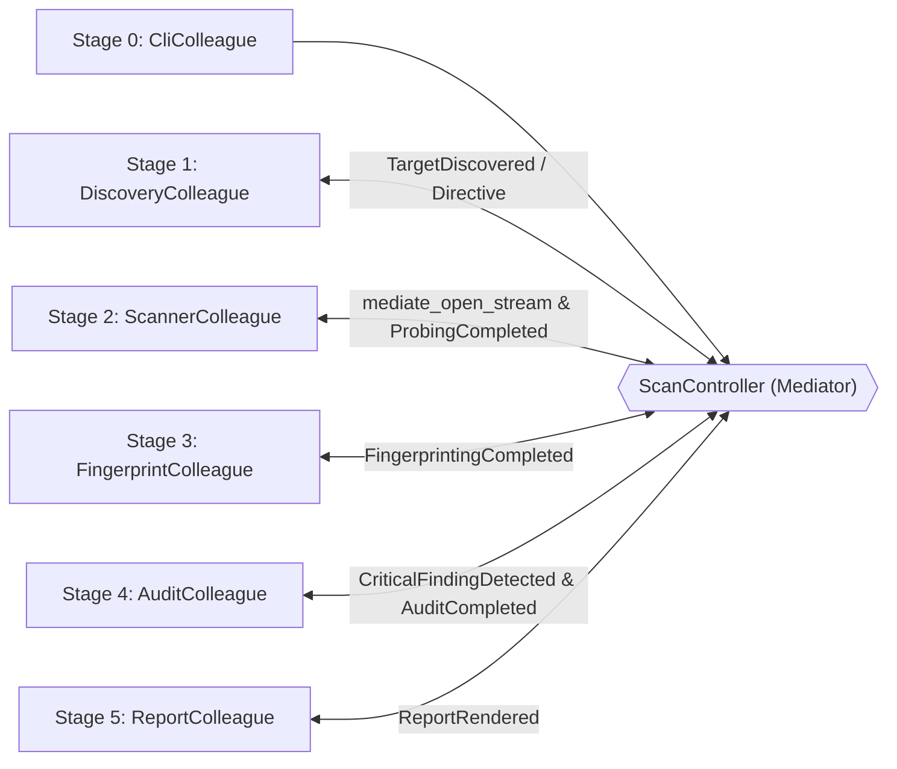

<pre align="center">
  
</pre>

<p align="center">
  
  
  
  
  
  
</p>

<p align="center">
  <b>⚡ Escáner de puertos TCP por etapas y auditor de superficie de ataque en Rust</b><br />
  <b>🦀 100% Rust `std` — 🧩 Patrón Mediator — 🔒 Lock-Free Concurrency — 🚀 Simplicidad `tcpscan`</b>
</p>

---

## 🚀 ¿Qué es `HXSCAN-RUST` (`tcpscan` v2.0)?

`HXSCAN-RUST` es la evolución completa en **Rust** del antiguo escáner en Python, rediseñado como una herramienta profesional de auditoría de ciberseguridad (**TCP Port Scanning & Attack Surface Auditing**) bajo dos pilares de ingeniería de software:

1. **Arquitectura Modular por Etapas gobernada por el Patrón de Diseño `Mediator` (*Mediador / Intermediary / Controller*)**:
   - Cada etapa (`DiscoveryColleague`, `ScannerColleague`, `FingerprintColleague`, `AuditColleague`, `ReportColleague`) está completamente desacoplada (**0 imports cruzados entre etapas**) y se comunica exclusivamente a través de [`ScanController`](src/mediator/controller.rs) mediante eventos tipados ([`ScanEvent`](src/mediator/contract.rs)) y directivas reactivas ([`MediatorDirective`](src/mediator/contract.rs)).
   - Documentación detallada y diagramas UML completos en [`ARCHITECTURE_MEDIATOR_UML.md`](ARCHITECTURE_MEDIATOR_UML.md).
2. **Cero Dependencias Externas (`100% Rust std`)**:
   - Sin crates de terceros: compilación limpia en segundos y **cero superficie de ataque por cadena de suministro (Supply-Chain Security)**.

---

## 🔥 ¿Por qué es mejor que la versión anterior?

| Dimensión | Versión Antigua (Python v1.0) | Nueva Versión (`HXSCAN-RUST` / `tcpscan` v2.0) |
|-----------|-------------------------------|-----------------------------------------------|
| **Lenguaje y Runtime** | Python interpretado (limitado por GIL) | **Rust nativo** (`LTO` + `opt-level = 3`), binario autónomo |
| **Arquitectura** | Script monolítico acoplado (`hxscan.py`) | **Modular en 5 Etapas + Patrón `Mediator`** (`0` acoplamiento cruzado) |
| **Deduplicación de Puertos** | `set[int]` en heap + `sorted()` | **`PortBitmap` en stack de `8 KiB` (`[u64; 1024]`)**, $O(1)$ memoria |
| **Concurrencia TCP** | `queue.Queue` + `threading.Lock` en cada puerto | **Lock-Free** (`AtomicUsize` + buffers locales por hilo, **0 Mutexes**) |
| **Semántica de Estados TCP** | Solo `open`, `closed`, `error` | **`open` (`SYN-ACK`), `closed` (`RST`), `filtered` (Firewall Drop) y `error` + RTT ($\mu\text{s}$)** |
| **Fingerprinting Activo** | Diccionario estático de 43 puertos | **70+ servicios (búsqueda binaria) + Active Banner Grabbing** sobre el mismo socket abierto |
| **Seguridad Terminal & Host** | Sin filtrado de respuesta | **Protección del Equipo de Origen (`--protect-origin`, Anti-DNS Rebinding, Anti-CSV Injection, Sanitización ANSI CSI/OSC, `#![forbid(unsafe_code)]`)** |
| **Auditoría Ciberseguridad** | Ninguna | **Motor de Riesgo (`CRITICAL` a `INFO`), Posture Score (`0-100`, Grado `A`–`F`) y alertas en vivo** |
| **Formatos de Salida** | Texto plano (con bug de puertos cerrados) | **Tabla Humana ANSI (solo abiertos por defecto), JSON (`--json` para SIEM) y CSV (`--csv`)** |
| **Ejecución CLI** | Obligatorio usar `-t <host> -p <ports>` | **Simplicidad posicional `tcpscan <host> [ports]`**, `host:port`, perfiles y flags clásicos |
| **Testing** | 15 tests básicos | **44 tests en Rust** (36 unitarios por etapa + 8 de integración y traza del Mediador) |

---

## 📥 Instalación Rápida

```bash
git clone https://github.com/hoxtxnDev/HXSCAN-RUST.git
cd HXSCAN-RUST
cargo build --release
```

> 💡 También puedes ejecutar directamente `./tcpscan`: si el binario `target/release/tcpscan` aún no existe, el script lo compila automáticamente.

---

## 🎯 Cómo se Utiliza de Forma Sencilla (`tcpscan`)

```bash
# 1️⃣ Escaneo inmediato con un solo argumento (escanea puertos críticos por defecto)
./tcpscan 127.0.0.1

# 2️⃣ Objetivo + puertos o rangos posicionales (¡sin necesidad de escribir -t ni -p!)
./tcpscan scanme.nmap.org 22,80,443,8000-8010

# 3️⃣ Sintaxis directa host:puerto
./tcpscan 192.168.1.10:8080

# 4️⃣ Perfiles tácticos de ciberseguridad
./tcpscan 10.0.0.1 --quick            # Top 20 puertos críticos (timeout 400ms)
./tcpscan 10.0.0.1 --stealth          # Puertos aleatorizados (Fisher-Yates) + rate-limiting
./tcpscan 10.0.0.1 --profile audit    # Auditoría profunda con Banner Grabbing y reintentos
./tcpscan 10.0.0.1 --full             # Barrido completo de los 65,535 puertos (512 hilos)

# 5️⃣ Modo de Protección Estricta del Equipo de Origen (bloquea escaneos a Loopback/Localhost)
./tcpscan 10.0.0.1 --protect-origin

# 6️⃣ Salida JSON estructurada para SIEM / SOAR / jq
./tcpscan 127.0.0.1 22,80,443,6379 --json

# 7️⃣ Salida CSV blindada contra Formula Injection (CWE-1236)
./tcpscan 127.0.0.1 22,80,443 --csv

# 8️⃣ 100% retrocompatible con las banderas clásicas de hxscan
./tcpscan -t 192.168.1.1 -p "22,80,443,8000-8100" --threads 100 --timeout 0.5 -v
```

> 🛡️ **Seguridad y Protección del Equipo de Origen**: Consulta el reporte completo de auditoría y blindaje en [`SECURITY.md`](SECURITY.md).

---

## 🧩 Arquitectura del Patrón Mediator (`src/`)

```text
📁 HXSCAN-RUST
├── 📄 Cargo.toml                        # Configuración Cargo (binarios: tcpscan y hxscan, LTO release)
├── 🚀 tcpscan                           # Lanzador directo endurecido (POSIX)
├── 📄 SECURITY.md                       # Auditoría de seguridad y blindaje del equipo de origen
├── 📄 ARCHITECTURE_MEDIATOR_UML.md      # Documentación de diseño, gráficos UML y plan de escalabilidad
├── 📁 src/
│   ├── 📄 lib.rs                        # API pública (#![forbid(unsafe_code)])
│   ├── 📄 main.rs                       # Entrypoint del binario `tcpscan`
│   ├── 📄 cli.rs                        # [Stage 0: CliColleague] Parser ergonómico + cuotas anti-DoS
│   ├── 📁 mediator/
│   │   ├── 📄 mod.rs                    # Exportaciones del Mediador
│   │   ├── 📄 contract.rs               # Trait `ScanMediator`, `ScanEvent`, `MediatorDirective` y DTOs
│   │   └── 📄 controller.rs             # `ScanController` (Mediador Concreto + Event Trace)
│   └── 📁 stages/
│       ├── 📄 mod.rs                    # Registro de los 5 Colegas desacoplados
│       ├── 📄 stage1_discovery.rs       # [Stage 1: DiscoveryColleague] DNS, Anti-Rebinding y PortBitmap (8 KiB)
│       ├── 📄 stage2_scanner.rs         # [Stage 2: ScannerColleague] Sondeo TCP Lock-Free + RTT
│       ├── 📄 stage3_fingerprint.rs     # [Stage 3: FingerprintColleague] 70+ servicios + Sanitización CSI/OSC
│       ├── 📄 stage4_audit.rs           # [Stage 4: AuditColleague] Riesgo SOC/Pentest y Posture Grade (A-F)
│       └── 📄 stage5_report.rs          # [Stage 5: ReportColleague] Renderizado ANSI, JSON y CSV seguro
└── 📁 tests/
    └── 📄 pipeline_integration.rs       # Suite de integración end-to-end y verificación del Mediador
```

### Diagrama UML Resumido de Mediación



*(Ver diagramas UML completos de Clases, Secuencia, Estados y Escalabilidad en [`ARCHITECTURE_MEDIATOR_UML.md`](ARCHITECTURE_MEDIATOR_UML.md)).*

---

## 🧪 Ejecución de Pruebas Unitarias y de Integración

```bash
cargo test
```

Incluye **44 pruebas automatizadas**:
- **36 pruebas unitarias** distribuidas en cada etapa (`PortBitmap` de 65,535 puertos, clasificación de alcance IP, bloqueo de DNS Rebinding y `0.0.0.0`, distribución multihilo *lock-free*, `MockStream` para sondas HTTP/Redis/SSH, sanitización ANSI CSI/OSC, protección CSV CWE-1236, escalado de severidad y formatos de reporte).
- **8 pruebas de integración** en [`tests/pipeline_integration.rs`](tests/pipeline_integration.rs) verificando la traza cronológica de eventos del **Mediator** (`event_trace`), directivas reactivas (`PublicTargetHardeningMode`, `FirewallDropDetected`, `EscalateCriticalAlert`), bloqueo `--protect-origin`, sockets no bloqueantes y códigos de salida (`0`, `1`, `2`).

---

## 🔢 Códigos de Salida

| Código | Significado |
|--------|-------------|
| ✅ `0` | Se encontraron puertos abiertos (`open`) |
| ❌ `1` | Error de argumentos, rango de puertos inválido o fallo DNS |
| 📭 `2` | Escaneo completado sin puertos abiertos |
| 🛑 `130` | Interrupción por usuario (`Ctrl+C`) |

---

<p align="center">
  🦀 <b>HXSCAN-RUST (`tcpscan`)</b> — Desarrollado por <a href="https://github.com/hoxtxnDev">@hoxtxnDev</a><br />
  <sub>🛡️ Auditorías de ciberseguridad, Pentesting y Operaciones SOC</sub>
</p>
