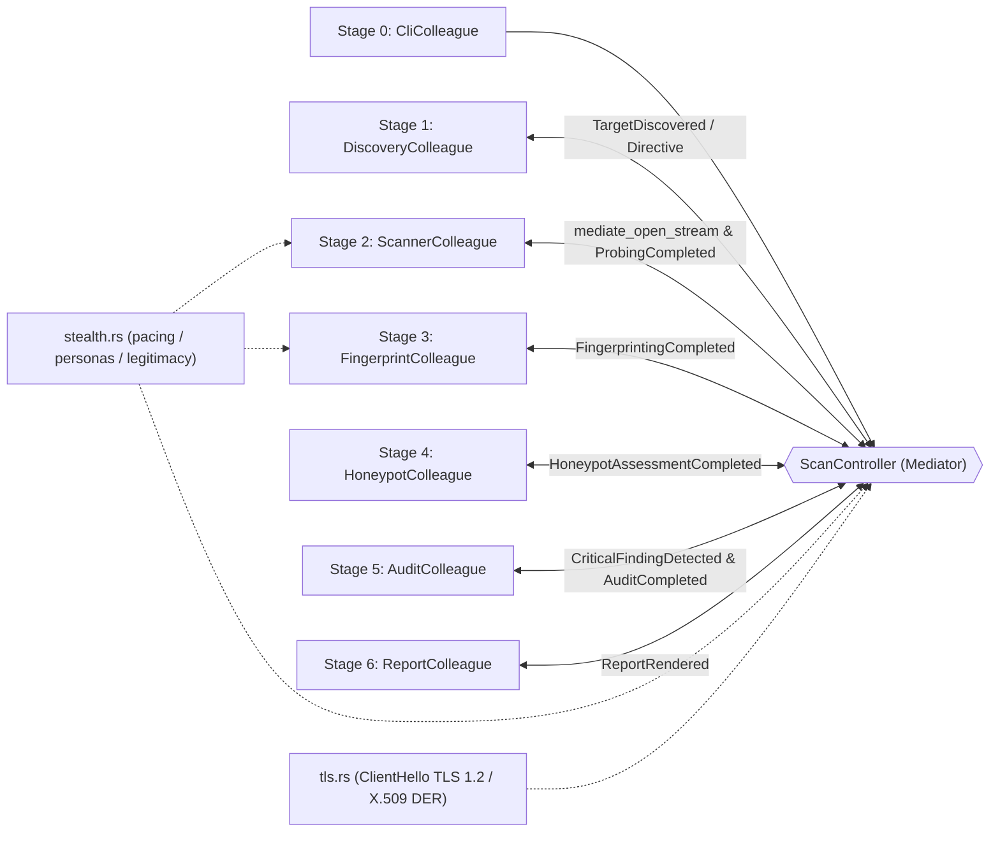

<pre align="center">
  
</pre>

<p align="center">
  
  
  
  
  
  
</p>

<p align="center">
  <b>⚡ Escáner de puertos TCP por etapas, auditor de superficie de ataque y analizador conductual de honeypots</b><br />
  <b>🦀 100% Rust `std` — 🧩 Patrón Mediator — 🥷 Stealth / Mutable — 🍯 Honeypot Detection</b>
</p>

---

> ⚠️ **Uso autorizado únicamente.** `HXSCAN-RUST` está diseñado para auditorías de seguridad con autorización escrita explícita. Los modos `stealth`, `mutable` y los filtros anti-IA reducen firmas evidentes de escaneo, pero **no garantizan** la evasión de sistemas AI/ML, IDS/IPS, EDR o soluciones de correlación. Consulta [`SECURITY.md`](SECURITY.md) antes de ejecutar la herramienta.

---

## 🚀 ¿Qué es `HXSCAN-RUST` (`tcpscan` v2.2)?

`HXSCAN-RUST` es la evolución completa en **Rust** del antiguo escáner en Python, rediseñado como una herramienta profesional de auditoría de ciberseguridad (**TCP Port Scanning, Attack Surface Auditing, TLS/X.509 Reconnaissance & Deception Detection**). La versión **2.2** añade reconocimiento TLS real, extracción de versiones de servicio y evidencia de certificado para la detección de honeypots, sobre la base de los modos de baja huella, camuflaje corporativo y sobre de legitimidad anti-IA introducidos en la 2.1. Mantiene intactos los dos pilares del proyecto:

1. **Arquitectura Modular gobernada por el Patrón de Diseño `Mediator` (*Mediador / Intermediary / Controller*)**:
   - Cada etapa (`DiscoveryColleague`, `ScannerColleague`, `FingerprintColleague`, `HoneypotColleague`, `AuditColleague`, `ReportColleague`) está completamente desacoplada (**0 imports cruzados entre etapas**) y se comunica exclusivamente a través de [`ScanController`](src/mediator/controller.rs) mediante eventos tipados ([`ScanEvent`](src/mediator/contract.rs)) y directivas reactivas ([`MediatorDirective`](src/mediator/contract.rs)).
   - La lógica transversal de cadencia, mutación y legitimidad vive en [`src/stealth.rs`](src/stealth.rs), compartida por Stage 2 y Stage 3 sin romper el patrón.
   - Documentación detallada y diagramas UML completos en [`ARCHITECTURE_MEDIATOR_UML.md`](ARCHITECTURE_MEDIATOR_UML.md).
2. **Cero Dependencias Externas (`100% Rust std`)**:
   - Sin crates de terceros: compilación limpia en segundos y **cero superficie de ataque por cadena de suministro (Supply-Chain Security)**.

---

## ✨ Novedades de la versión 2.2

| Capacidad | Qué aporta |
|-----------|------------|
| 🔐 **Reconocimiento TLS 1.2** | `ClientHello` mínimo con SNI sobre el socket ya abierto; el handshake se detiene tras el certificado del servidor. **No descifra tráfico ni completa la sesión.** |
| 📜 **Inteligencia X.509** | Subject/Issuer CN, DNS SANs, `notAfter`, días restantes, autofirmado, mismatch de hostname y longitud de cadena anunciada. |
| 🏷️ **Versión de servicio** | Extracción conservadora de producto/versión desde banners SSH, HTTP, FTP, SMTP, MySQL y Redis (columna `Version` en el reporte humano). |
| 🍯 **Evidencia de certificado** | `self-signed-certificate`, `certificate-hostname-mismatch`, `expired-certificate` y `default-certificate-identity` se suman al score conductual de honeypot. |
| 📊 **Reportes ampliados** | Sección `[TLS Certificate Intelligence]` en texto, bloque `tls` + `service_version` en JSON y 7 columnas TLS en CSV. |
| 🧪 **Cobertura reforzada** | Parser DER/X.509, `ClientHello`, extracción de versiones y captura TLS end-to-end contra un servidor loopback instrumentado. |

### Límites de seguridad del reconocimiento TLS

- Solo se intenta en puertos TLS habituales (`443`, `465`, `636`, `853`, `993`, `995`, `2376`, `5986`, `6443`, `8443`, `8883`, `9443`) y con `grab_banners` activo.
- En `--stealth` los banners están desactivados por defecto, por lo que **no se capturan certificados** salvo que se habilite explícitamente.
- La herramienta **no valida firmas, no completa el handshake y no deriva claves**: el certificado se trata como metadato de reconocimiento, no como prueba criptográfica.
- Un certificado puede ser spoofeado por un endpoint engañoso; las señales TLS son **evidencia corroborante**, no un veredicto definitivo.

---

## ✨ Base de la versión 2.1

| Capacidad | Qué aporta |
|-----------|------------|
| 🥷 **Modo `--stealth`** | Puertos aleatorizados, jitter, techo global de paquetes por segundo, ráfagas humanas, backoff adaptativo y banners desactivados por defecto. |
| 🎭 **Modo `--mutable`** | Perfil de camuflaje corporativo: persona de estación de trabajo empresarial, ráfagas tipo usuario real y cabeceras HTTP mutadas. |
| 🧠 **Filtros anti-IA (`--ai-filter`)** | Sobre de legitimidad que mantiene la cadencia dentro de envelopes de tráfico empresarial y calcula un **score de legitimidad** honesto en el reporte. |
| 🍯 **Clasificación de honeypots** | Nuevo `HoneypotColleague` que clasifica cada puerto como `clean`, `possible-honeypot` o `honeypot`, explicando el **comportamiento observado**. |
| 🪤 **Detección por comportamiento** | Firmas Cowrie/Kippo/Dionaea/Thinkst, puertos señuelo, incoherencias protocolo-servicio, tarpits, exposición masiva, RTT uniforme, banners clonados y más. |
| 📊 **Telemetría ampliada** | Reporte humano con columna `Honeypot`, sección de comportamiento, línea de legitimidad y bloques `stealth`/`honeypot` en JSON/CSV. |
| 🧩 **6 colegas desacoplados** | `HoneypotColleague` se insertó como Stage 4 sin tocar la lógica interna de los demás colegas: prueba real de escalabilidad plug-and-play. |

---

## 🔥 ¿Por qué es mejor que la versión anterior?

| Dimensión | Versión Antigua (Python v1.0) | Nueva Versión (`HXSCAN-RUST` / `tcpscan` v2.2) |
|-----------|-------------------------------|-----------------------------------------------|
| **Lenguaje y Runtime** | Python interpretado (limitado por GIL) | **Rust nativo** (`LTO` + `opt-level = 3`), binario autónomo |
| **Arquitectura** | Script monolítico acoplado (`hxscan.py`) | **Modular en 6 Etapas + Patrón `Mediator`** (`0` acoplamiento cruzado) |
| **Deduplicación de Puertos** | `set[int]` en heap + `sorted()` | **`PortBitmap` en stack de `8 KiB` (`[u64; 1024]`)**, $O(1)$ memoria |
| **Concurrencia TCP** | `queue.Queue` + `threading.Lock` en cada puerto | **Hot path Lock-Free** (`AtomicUsize` + buffers locales por hilo; `Mutex` solo en cold path al guardar certificados TLS) |
| **Semántica de Estados TCP** | Solo `open`, `closed`, `error` | **`open` (`SYN-ACK`), `closed` (`RST`), `filtered` (Firewall Drop) y `error` + RTT ($\mu\text{s}$)** |
| **Fingerprinting Activo** | Diccionario estático de 43 puertos | **70+ servicios (búsqueda binaria) + Active Banner Grabbing** sobre el mismo socket abierto |
| **Modos Evasivos** | Ninguno | **`--stealth` (bajo ruido) y `--mutable` (camuflaje corporativo)** con jitter, rate ceiling, bursts y backoff adaptativo |
| **Mutación de Tráfico** | Ninguna | **5 personas empresariales** y cabeceras HTTP mutadas (`User-Agent`, `Accept`, `Accept-Language`, etc.) |
| **Anti-IA / Legitimidad** | Ninguno | **Sobre de legitimidad**, score `0-100` y grado `A`–`F` incluidos en el reporte |
| **Detección de Honeypots** | Ninguna | **Clasificación conductual** `clean` / `possible-honeypot` / `honeypot` con evidencias explicables |
| **Reconocimiento TLS/X.509** | Ninguno | **`ClientHello` TLS 1.2 + parser DER**: CN, SANs, expiración, autofirmado, mismatch y cadena, sin descifrar tráfico |
| **Versión de Servicio** | Diccionario estático | **Extracción desde banners reales** (`OpenSSH_9.7p1`, `nginx/1.26.0`, `vsFTPd 3.0.5`, etc.) |
| **Seguridad Terminal & Host** | Sin filtrado de respuesta | **Protección del Equipo de Origen (`--protect-origin`, Anti-DNS Rebinding, Anti-CSV Injection, Sanitización ANSI CSI/OSC, `#![forbid(unsafe_code)]`)** |
| **Auditoría Ciberseguridad** | Ninguna | **Motor de Riesgo (`CRITICAL` a `INFO`), Posture Score (`0-100`, Grado `A`–`F`) y alertas en vivo** |
| **Formatos de Salida** | Texto plano (con bug de puertos cerrados) | **Tabla Humana ANSI, JSON (`--json` para SIEM) y CSV (`--csv`) con telemetría stealth y honeypot** |
| **Ejecución CLI** | Obligatorio usar `-t <host> -p <ports>` | **Simplicidad posicional `tcpscan <host> [ports]`**, `host:port`, perfiles y flags clásicos |
| **Testing** | 15 tests básicos | **74 tests en Rust** (62 unitarios + 12 de integración, incluyendo TLS/X.509 y captura end-to-end) |

---

## 📥 Instalación Rápida

```bash
git clone https://github.com/hoxtxnDev/HXSCAN-RUST.git
cd HXSCAN-RUST
cargo build --release
```

> 💡 También puedes ejecutar directamente `./tcpscan`: si el binario `target/release/tcpscan` aún no existe, el script lo compila automáticamente.

---

## 🎯 Cómo se Utiliza de Forma Sencilla (`tcpscan`)

```bash
# 1️⃣ Escaneo inmediato con un solo argumento (escanea puertos críticos por defecto)
./tcpscan 127.0.0.1

# 2️⃣ Objetivo + puertos o rangos posicionales (¡sin necesidad de escribir -t ni -p!)
./tcpscan scanme.nmap.org 22,80,443,8000-8010

# 3️⃣ Sintaxis directa host:puerto
./tcpscan 192.168.1.10:8080

# 4️⃣ Perfiles tácticos de ciberseguridad
./tcpscan 10.0.0.1 --quick            # Top 20 puertos críticos (timeout 400ms)
./tcpscan 10.0.0.1 --stealth          # Bajo ruido: shuffle + jitter + rate ceiling
./tcpscan 10.0.0.1 --mutable          # Camuflaje corporativo (persona + bursts + banners)
./tcpscan 10.0.0.1 --profile audit    # Auditoría profunda con Banner Grabbing y reintentos
./tcpscan 10.0.0.1 --full             # Barrido completo de los 65,535 puertos (512 hilos)

# 5️⃣ Modo de Protección Estricta del Equipo de Origen (bloquea escaneos a Loopback/Localhost)
./tcpscan 10.0.0.1 --protect-origin

# 6️⃣ Salida JSON estructurada para SIEM / SOAR / jq
./tcpscan 127.0.0.1 22,80,443,6379 --json

# 7️⃣ Salida CSV blindada contra Formula Injection (CWE-1236)
./tcpscan 127.0.0.1 22,80,443 --csv

# 8️⃣ 100% retrocompatible con las banderas clásicas de hxscan
./tcpscan -t 192.168.1.1 -p "22,80,443,8000-8100" --threads 100 --timeout 0.5 -v
```

> 🛡️ **Seguridad y Protección del Equipo de Origen**: Consulta el reporte completo de auditoría y blindaje en [`SECURITY.md`](SECURITY.md).

---

## 🥷 Modos de Operación: `normal`, `stealth` y `mutable`

| Parámetro | `normal` | `--stealth` | `--mutable` |
|-----------|----------|-------------|-------------|
| **Objetivo** | Máxima velocidad | Bajo ruido / auditoría discreta | Integrarse en tráfico corporativo |
| **Hilos por defecto** | 100 | 10 | 4 |
| **Orden de puertos** | Secuencial | Aleatorizado (Fisher-Yates) | Aleatorizado (Fisher-Yates) |
| **Jitter** | 0 ms | 120 ms | 80 ms |
| **Techo global** | Sin límite | 3 pps | 6 pps |
| **Ráfagas** | Desactivadas | 1 sonda + pausa 900 ms | 5 sondas + pausa 500 ms |
| **Banners activos** | Sí | No (por defecto) | Sí |
| **Persona HTTP** | `generic` | `generic` | `corporate` |
| **Backoff adaptativo** | No | Sí | Sí |
| **AI-Filter / telemetría** | No | Sí | Sí |

### 🥷 `--stealth`: baja huella

- **Jitter uniforme** por sonda (`--jitter-ms`, `0..=5000`).
- **Techo global de paquetes por segundo** (`--max-pps`, `0..=1000`; `0` = ilimitado), repartido entre los workers.
- **Ráfagas y pausas** (`--burst`, `--burst-pause-ms`) para evitar patrones constantes y fácilmente correlacionables.
- **Backoff exponencial adaptativo** (hasta `8x`) cuando aparecen puertos `filtered` o errores, y reset automático al volver a estados normales.
- **Banners desactivados por defecto** para reducir la interacción activa con servicios desconocidos.

### 🎭 `--mutable`: camuflaje corporativo

El modo mutable combina cadencia humana con una **identidad de cliente legítima**:

| Persona (`--persona`) | Identidad simulada |
|------------------------|--------------------|
| `generic` | Navegador neutral (Chrome/Safari) |
| `corporate` | Estación de trabajo Windows gestionada (Edge/Chrome) |
| `browser` | Firefox de escritorio (Windows/Linux) |
| `windows-update` | Windows Update / Delivery Optimization |
| `backup-agent` | Microsoft BITS / agente de backup empresarial |

En sondas HTTP, `Stage 3` muta `User-Agent`, `Accept`, `Accept-Language`, `Host`, `Upgrade-Insecure-Requests` y `Connection`, eliminando la firma explícita de `tcpscan`. `Accept-Encoding: identity` se mantiene intencionalmente para que el banner siga siendo imprimible y sanitizable.

```bash
# Camuflaje corporativo con ajustes finos
./tcpscan 10.0.0.7 --mutable \
  --persona corporate \
  --jitter-ms 90 \
  --max-pps 5 \
  --burst 4 \
  --burst-pause-ms 700 \
  --decoy-probes 8

# Forzar una identidad de actualización de Windows
./tcpscan 10.0.0.7 80,443 --mutable --persona windows-update

# Stealth con banners y persona de navegador (mayor interacción)
./tcpscan 10.0.0.7 --stealth --banner --persona browser
```

> 🪤 **Decoys**: `--decoy-probes N` intercala hasta `128` sondas señuelo **solo contra el mismo objetivo autorizado** (puertos empresariales habituales como `53`, `80`, `443`, `445`, `993`, `8080`, `8443`). Sus resultados se descartan y **nunca** se envían a terceros.

---

## 🧠 Filtros Anti-IA y Sobre de Legitimidad

La v2.1 incorpora un **sobre de legitimidad** diseñado para que un sistema defensivo no clasifique automáticamente una auditoría **autorizada** como tráfico malicioso. No es un mecanismo de evasión garantizada: es una combinación de control de cadencia, mutación de identidad y telemetría honesta.

El score `0..=100` se calcula en [`assess_legitimacy`](src/stealth.rs) a partir de:

| Factor | Efecto aproximado |
|--------|-------------------|
| Base neutral | `65` |
| Modo `stealth` / `mutable` | `+20` / `+25` |
| `--ai-filter` activo | `+8` |
| Jitter configurado | `+5` (`+3` extra si ≥ 50 ms) |
| `--max-pps ≤ 10` / `≤ 50` / `≤ 100` | `+10` / `+6` / `+2` |
| `--max-pps > 200` | `-10` |
| Ráfagas configuradas | `+4` |
| Persona distinta de `generic` | `+4` |
| Backoff adaptativo | `+4` |
| Sin banners / banners + persona `generic` | `+2` / `-8` |
| Ratio `filtered > 20%` / `> 50%` | `-5` / `-15` |

| Score | Grado | Interpretación |
|-------|-------|----------------|
| `85–100` | `A` | Configuración muy alineada con tráfico empresarial |
| `70–84` | `B` | Buena cobertura de controles |
| `55–69` | `C` | Cobertura parcial; revisar cadencia/persona |
| `40–54` | `D` | Huella de escáner todavía evidente |
| `0–39` | `F` | Configuración de alto ruido |

> 🧠 `--ai-filter` controla el **libro de contabilidad y la telemetría de legitimidad**. Las palancas que realmente modifican el tráfico (`--jitter-ms`, `--max-pps`, `--burst`, `--persona`, `--adaptive-pacing`) actúan de forma independiente. Un score alto **no certifica** que el scan vaya a pasar desapercibido.

---

## 🍯 Clasificación Conductual de Honeypots (`Stage 4`)

El nuevo `HoneypotColleague` analiza **todos** los puertos enriquecidos y emite un veredicto por puerto, junto con las evidencias que lo justifican.

| Veredicto | Umbral | Significado |
|-----------|--------|-------------|
| `clean` | `score < 30` | Sin indicadores relevantes de engaño |
| `possible-honeypot` | `30 ≤ score < 70` | Señales débiles/medias; corroborar antes de interactuar |
| `honeypot` | `score ≥ 70` | Evidencia fuerte: firma conocida, servicios contradictorios o exposición masiva |

### Evidencias y pesos

| Comportamiento | Peso | Disparador |
|----------------|------|------------|
| `known-honeypot-signature` | 80 | Banner coincide con Cowrie, Kippo, Dionaea, Glastopf, Honeyd, Thinkst Canary, Conpot, Endlessh, etc. |
| `mass-open-services` | 45 | ≥ 10 puertos abiertos y ≥ 35% de los puertos escaneados |
| `service-port-mismatch` | 35 | El banner habla un protocolo distinto al servicio/puerto esperado |
| `certificate-hostname-mismatch` | 30 | El certificado presentado no cubre el hostname solicitado por SNI |
| `contradictory-banner` | 30 | Un mismo banner mezcla protocolos incompatibles |
| `cloned-banners` | 25 | ≥ 3 servicios devuelven exactamente el mismo banner |
| `self-signed-certificate` | 25 | Certificado hoja autofirmado (subject == issuer) |
| `default-certificate-identity` | 25 | Identidad de laboratorio/por defecto (`localhost`, `*.local`, `example.com`, etc.) |
| `honeypot-port` | 20 | Puerto típico de despliegues honeypot (`2222`, `2323`, `4444`, `9999`, `31337`, etc.) |
| `tarpit-latency` | 20 | Handshake > 2.5 s fuera de loopback |
| `uniform-rtt` | 20 | ≥ 6 servicios con una dispersión de RTT ≤ 200 µs |
| `honeypot-port-cluster` | 20 | ≥ 3 puertos típicos de honeypot abiertos en el mismo objetivo |
| `default-credential-prompt` | 20 | Prompt interactivo de credenciales en un servicio inesperado |
| `expired-certificate` | 15 | Certificado fuera de vigencia según `notAfter` |
| `fake-version-disclosure` | 15 | Versiones legacy/falsas típicas de frameworks de decepción |
| `bannerless-interactive-service` | 10 | Servicio interactivo que acepta conexión pero no envía banner |
| `unusual-ephemeral-service` | 10 | Servicio expuesto en un puerto efímero (`≥ 49152`) |

### Señales agregadas

- **Exposición masiva**: `open_count ≥ 10` y `open_count ≥ 35%` del total escaneado.
- **RTT uniforme**: al menos 6 puertos abiertos con RTT máximo-mínimo `≤ 200 µs` (excluye loopback).
- **Banners clonados**: 3 o más puertos con el mismo banner (longitud ≥ 8 caracteres).
- **Clúster de puertos señuelo**: 3 o más puertos de la lista de honeypots típicos.

### Ejemplo de salida

```text
Mode: mutable | Persona: corporate | AI-Filter: on | Legitimacy: 93/100 (A)
...
Port     State      RTT        Service          Version          Risk     Honeypot   Banner / Details
2222     open       0.90ms     SSH              -                LOW      HONEYPOT   SSH-2.0-Cowrie-1.0

[Honeypot & Deception Behavior Analysis]
  • Port 2222  (SSH): HONEYPOT 100/100 — known-honeypot-signature, honeypot-port
    banner matches a known deception framework; port is frequently used by honeypot deployments

Scanned: 120 port(s) | Open: 4 | Closed: 110 | Filtered: 6 | Honeypots: 1 confirmed / 0 possible | Posture Grade: B (Score: 18/100)
```

> 🍯 Un veredicto `possible-honeypot` o `honeypot` es una **hipótesis basada en comportamiento observable**, no una prueba forense. Corrobora siempre con contexto del activo, propietario y ventana de auditoría.

---

## 🔐 Reconocimiento TLS y Versión de Servicio (`Stage 2` / `Stage 3`)

En puertos TLS habituales, el Mediador realiza un `ClientHello` TLS 1.2 **mínimo** sobre el socket ya abierto y lee únicamente el mensaje `Certificate` del servidor. No se completa el handshake, no se validan firmas, no se derivan claves y **no se descifra ni se envía tráfico de aplicación**.

```text
[TLS Certificate Intelligence]
  • Port 443   CN=portal.example.com | issuer=Example CA | expires=2027-03-01 12:00:00Z (110d) | self-signed=no | SANs=portal.example.com, www.example.com | chain=2
  • Port 8443  CN=localhost | issuer=localhost | expires=2025-01-01 00:00:00Z (-310d) | self-signed=yes | SANs=localhost | chain=1
    certificate does not match the requested hostname
```

Metadatos extraídos:

| Campo | Uso |
|-------|-----|
| `subject_cn` / `issuer_cn` | Identidad del servicio y emisor |
| `sans` | Nombres DNS cubiertos (máx. 16) |
| `not_after` / `days_until_expiry` | Vigencia y días restantes (negativos = expirado) |
| `self_signed` | `subject == issuer` (heurística) |
| `hostname_mismatch` | El certificado no cubre el hostname solicitado |
| `chain_length` | Nº de certificados anunciados por el servidor |

La **versión de servicio** se extrae de banners ya capturados, sin tráfico adicional:

```text
Port     State      RTT        Service          Version          Risk     Honeypot   Banner / Details
22       open       0.42ms     SSH              OpenSSH_9.7p1    LOW      CLEAN      SSH-2.0-OpenSSH_9.7p1 Ubuntu-3
443      open       0.31ms     HTTPS            nginx/1.26.2     INFO     CLEAN      HTTP/1.1 200 OK (nginx/1.26.2)
```

> 🔒 **Alcance**: el reconocimiento TLS está pensado para inventariar certificados y detectar identidades débiles o de laboratorio. No sustituye a un escáner TLS especializado (cifrados, protocolos obsoletos, cadena de confianza completa) y no debe usarse para interceptar comunicaciones.

---

## 🧩 Arquitectura del Patrón Mediator (`src/`)

```text
📁 HXSCAN-RUST
├── 📄 Cargo.toml                        # Configuración Cargo (binarios: tcpscan y hxscan, LTO release)
├── 🚀 tcpscan                           # Lanzador directo endurecido (POSIX)
├── 📄 SECURITY.md                       # Auditoría de seguridad, controles anti-IA y uso responsable
├── 📄 ARCHITECTURE_MEDIATOR_UML.md      # Documentación de diseño, gráficos UML y plan de escalabilidad
├── 📁 src/
│   ├── 📄 lib.rs                        # API pública (#![forbid(unsafe_code)])
│   ├── 📄 main.rs                       # Entrypoint del binario `tcpscan`
│   ├── 📄 cli.rs                        # [Stage 0: CliColleague] Parser ergonómico, perfiles y cuotas
│   ├── 📄 stealth.rs                    # PacingController, jitter, decoys, personas y score de legitimidad
│   ├── 📄 tls.rs                        # ClientHello TLS 1.2 + parser DER/X.509 de reconocimiento
│   ├── 📁 mediator/
│   │   ├── 📄 mod.rs                    # Exportaciones del Mediador
│   │   ├── 📄 contract.rs               # Trait `ScanMediator`, eventos, directivas y DTOs stealth/honeypot/TLS
│   │   └── 📄 controller.rs             # `ScanController` (Mediador Concreto + Event Trace + captura TLS)
│   └── 📁 stages/
│       ├── 📄 mod.rs                    # Registro de los 6 Colegas desacoplados
│       ├── 📄 stage1_discovery.rs       # [Stage 1: DiscoveryColleague] DNS, Anti-Rebinding y PortBitmap (8 KiB)
│       ├── 📄 stage2_scanner.rs         # [Stage 2: ScannerColleague] Sondeo TCP Lock-Free + PacingController
│       ├── 📄 stage3_fingerprint.rs     # [Stage 3: FingerprintColleague] 70+ servicios, versiones y TLS
│       ├── 📄 stage4_honeypot.rs        # [Stage 4: HoneypotColleague] Clasificación conductual + señales TLS
│       ├── 📄 stage5_audit.rs           # [Stage 5: AuditColleague] Riesgo SOC/Pentest + veredictos honeypot
│       └── 📄 stage6_report.rs          # [Stage 6: ReportColleague] ANSI, JSON y CSV con TLS/honeypot
└── 📁 tests/
    └── 📄 pipeline_integration.rs       # Suite de integración end-to-end y verificación del Mediador
```

### Diagrama UML Resumido de Mediación



*(Ver diagramas UML completos de Clases, Secuencia, Estados, Topología y flujos de decisión en [`ARCHITECTURE_MEDIATOR_UML.md`](ARCHITECTURE_MEDIATOR_UML.md)).*

---

## 📡 Salida JSON y CSV

El reporte JSON incluye bloques `stealth`, `summary`, `tls` y `honeypot` para automatización SOC/SOAR:

```json
{
  "scanner": "tcpscan-rs",
  "version": "2.2.0",
  "pattern": "Mediator",
  "stealth": {
    "mode": "mutable",
    "persona": "corporate",
    "ai_filter": true,
    "max_pps": 6.0,
    "jitter_ms": 80,
    "legitimacy_score": 93,
    "legitimacy_grade": "A"
  },
  "summary": {
    "possible_honeypots": 0,
    "confirmed_honeypots": 1
  },
  "ports": [
    {
      "port": 443,
      "state": "open",
      "service": "HTTPS",
      "service_version": "nginx/1.26.2",
      "tls": {
        "subject_cn": "portal.example.com",
        "issuer_cn": "Example CA",
        "sans": ["portal.example.com", "www.example.com"],
        "not_after": "2027-03-01 12:00:00Z",
        "days_until_expiry": 110,
        "self_signed": false,
        "hostname_mismatch": false,
        "chain_length": 2
      },
      "honeypot": {
        "verdict": "clean",
        "score": 0,
        "behaviors": []
      }
    }
  ]
}
```

El CSV incorpora `service_version` y siete columnas TLS (`tls_subject_cn`, `tls_issuer_cn`, `tls_self_signed`, `tls_hostname_mismatch`, `tls_days_until_expiry`, `tls_not_after`, `tls_sans`), manteniendo la neutralización de fórmulas CWE-1236.

---

## 🧪 Ejecución de Pruebas Unitarias y de Integración

```bash
cargo test
```

Incluye **74 pruebas automatizadas**:
- **62 pruebas unitarias** distribuidas en cada etapa, `stealth.rs` y `tls.rs` (`PortBitmap` de 65,535 puertos, clasificación de alcance IP, bloqueo de DNS Rebinding y `0.0.0.0`, distribución multihilo *lock-free*, `MockStream` para sondas HTTP/Redis/SSH, mutación de cabeceras por persona, pacing adaptativo, jitter, decoys, sanitización ANSI CSI/OSC, protección CSV CWE-1236, escalado de severidad, firmas y señales agregadas de honeypot, **parser DER/X.509, SNI, SAN, wildcard matching, expiración, self-signed y ClientHello TLS 1.2**, extracción de versiones y formatos de reporte).
- **12 pruebas de integración** en [`tests/pipeline_integration.rs`](tests/pipeline_integration.rs) verificando la traza cronológica del **Mediator** (`event_trace`), directivas reactivas (`PublicTargetHardeningMode`, `FirewallDropDetected`, `AdaptivePacingEngaged`, `PossibleHoneypotDetected`, `ConfirmedHoneypotDetected`, `EscalateCriticalAlert`), telemetría `mutable`, clasificación de honeypots, bloqueo `--protect-origin`, **captura TLS end-to-end contra un servidor loopback instrumentado**, sockets y códigos de salida (`0`, `1`, `2`).

---

## 🔢 Códigos de Salida

| Código | Significado |
|--------|-------------|
| ✅ `0` | Se encontraron puertos abiertos (`open`) |
| ❌ `1` | Error de argumentos, rango de puertos inválido o fallo DNS |
| 📭 `2` | Escaneo completado sin puertos abiertos |
| 🛑 `130` | Interrupción por usuario (`Ctrl+C`) |

---

## ⚖️ Uso Responsable

- Ejecuta la herramienta **solo** contra activos propios o con autorización escrita explícita.
- Los modos `stealth`, `mutable` y los filtros anti-IA están pensados para **auditorías autorizadas**, no para ocultar actividad maliciosa.
- Respeta las leyes locales, los acuerdos de alcance (*Rules of Engagement*) y las políticas de la organización.
- No uses `--decoy-probes` para generar tráfico hacia terceros: el diseño lo restringe al objetivo autorizado.
- Documenta y conserva la evidencia de autorización antes de cada auditoría.

---

<p align="center">
  🦀 <b>HXSCAN-RUST (`tcpscan`)</b> — Desarrollado por <a href="https://github.com/hoxtxnDev">@hoxtxnDev</a><br />
  <sub>🛡️ Auditorías de ciberseguridad, Pentesting y Operaciones SOC</sub>
</p>
